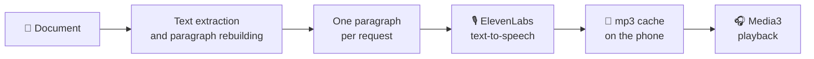

<div align="center">


# Leggimi

**Turn your documents into audiobooks, read by [ElevenLabs](https://elevenlabs.io) voices.**

PDFs, Word files, EPUBs, notes: open them on your phone and listen while you drive, cook or walk.

[](https://github.com/SimoneFaricelli/leggimi/releases/latest)


### [⬇️ Download the APK](https://github.com/SimoneFaricelli/leggimi/releases/latest)

</div>

> [!NOTE]
> *Leggimi* is Italian for "read me". The app's interface is in Italian. The voices can read any language that the ElevenLabs model you pick supports.

---

## ✨ Why Leggimi

Got a handout, a manual or a novel and no time to sit down and read it? Leggimi extracts the text from the document, splits it into paragraphs and has an ElevenLabs voice read it to you. You get an audiobook with the natural delivery of a real narrator, in the voice you choose.

<table>
<tr>
<td width="50%" valign="top">

### 📚 Any document
Leggimi opens PDF, Word (DOCX), ODT, EPUB, RTF, HTML, Markdown and TXT files. You can import them inside the app, or use **Open with** or **Share** from any other app.

</td>
<td width="50%" valign="top">

### 🎙️ The voice you like
Every voice in your ElevenLabs account is available, with search, filters and preview. Pick one voice and model for everything, or a different voice for each book.

</td>
</tr>
<tr>
<td valign="top">

### 👆 Tap and listen
The text scrolls as you listen, with the current paragraph highlighted. Tap any paragraph to start reading from there. The chapter index takes you straight to the part you want.

</td>
<td valign="top">

### 🎧 A real audio player
Playback keeps going in the background. You can control it from the notification, the lock screen and your headphones. Speed goes from 0.75× to 2×, and a sleep timer can stop after a set time or at the end of the chapter.

</td>
</tr>
<tr>
<td valign="top">

### 💰 Pay once
Generated audio is stored on your phone, so listening again costs no credits. If you switch voice and later switch back, Leggimi reuses the audio you already paid for.

</td>
<td valign="top">

### 📍 Pick up where you left off
Every document remembers where you stopped. The library shows how far along you are in each one.

</td>
</tr>
</table>

## 🚀 Get started in three minutes

1. **Install.** On your phone, download `Leggimi-x.y.z.apk` from the [releases](https://github.com/SimoneFaricelli/leggimi/releases/latest) and open it. Android will ask you to allow installs from unknown sources.
2. **Connect ElevenLabs.** Open ⚙️ **Impostazioni** (Settings), paste your API key and tap **Salva e verifica** (Save and verify). Your plan and remaining characters appear.
   > Create a key at *elevenlabs.io → Settings → API Keys*. It needs at least the *Text to Speech*, *Voices (read)*, *Models (read)* and *User (read)* permissions.
3. **Choose a voice and a model.**
   - *Eleven Multilingual v2*: the best quality for long texts.
   - *Flash v2.5*: faster and cheaper.
4. **Add a document** from the library and press ▶️.

## 🧠 How it works



<details>
<summary><b>PDFs read like a book, not like a pile of lines</b></summary>

<br>

A PDF has no paragraphs, only lines placed on a page. Leggimi rebuilds the paragraphs from the position, spacing and font size of each line. Two lines stay together unless something clearly starts a new paragraph:

- a bullet or numbered item begins;
- the vertical gap between the lines is large;
- the font size changes;
- a sentence ends on a short line, or is followed by an indented line.

As a result:
- bulleted lists stay whole;
- paragraphs that continue onto the next page don't get split;
- hyphenated words broken across lines are joined back together;
- repeated headers, footers and page numbers are not read aloud.

If the PDF has bookmarks, they become the chapter index.

</details>

<details>
<summary><b>Smooth delivery, no waiting</b></summary>

<br>

Each paragraph goes to ElevenLabs together with up to 500 characters of the text before and after it. This keeps the voice's intonation consistent from one paragraph to the next. While you listen, Leggimi generates upcoming paragraphs in advance (at least 1,500 characters), so the next part plays without a pause.

</details>

<details>
<summary><b>Credits under control</b></summary>

<br>

ElevenLabs bills by the characters it reads. Each mp3 is stored under a key built from its text, voice, model and voice settings, so replaying a passage costs nothing. Settings show how much space the cache uses and let you clear it. Playback speed is applied on the phone, so changing it never regenerates audio.

</details>

## 🔒 Privacy

- **Your API key** stays on your phone, encrypted with the Android Keystore (AES-GCM), and is never included in backups.
- **Your documents** are copied into the app's private storage. The text to be read is sent only to ElevenLabs.
- **No middleman server**, no usage analytics, no ads.

## ❓ FAQ

<details>
<summary><b>How much does it cost?</b></summary>
<br>
The app is free. You only pay for the characters ElevenLabs synthesizes, according to your plan; the free plan works too. After the first listen, replaying is free.
</details>

<details>
<summary><b>Does it work offline?</b></summary>
<br>
Yes for anything already played or generated in advance, since it is stored on the phone. Generating new audio needs an internet connection.
</details>

<details>
<summary><b>My PDF won't import: "non contiene testo selezionabile" (no selectable text).</b></summary>
<br>
It is most likely a scan: the pages are images, not text. Leggimi does not do OCR. Run the PDF through an OCR tool first, then import it.
</details>

<details>
<summary><b>What about .doc files (Word 97–2003)?</b></summary>
<br>
They are not supported. Save them as .docx from Word or LibreOffice.
</details>

## 🛠️ Building from source

All you need is **Docker**. The whole Android toolchain (JDK 21, SDK 37, Gradle 9.9) lives in the image defined in [`docker/Dockerfile`](docker/Dockerfile).

```bash
build/build.sh                # tests + debug APK   → dist/Leggimi-debug.apk
build/build.sh release        # tests + signed APK  → dist/Leggimi-<version>.apk
build/build.sh -- lintDebug   # any Gradle task
```

> [!IMPORTANT]
> The first `release` build creates a keystore in `~/.leggimi-keystore/`. **Back it up**: without it you can't install updates over the existing app.

[`samples/`](samples) contains three test documents (DOCX, PDF, Markdown).

<details>
<summary><b>Project layout</b></summary>

```
app/src/main/java/it/faricelli/leggimi/
  data/extract/   text extractors, one per format (PDF: paragraph rebuilding)
  data/text/      document model and Segmenter (paragraphs → synthesis requests)
  data/eleven/    ElevenLabs REST client
  data/audio/     mp3 cache
  data/db/        Room: library and reading position
  data/settings/  DataStore and encrypted API key
  player/         PlayerEngine (queue, prefetch, sleep timer) and PlaybackService (Media3)
  ui/             Compose screens: library, reader, settings, voice and model pickers
```

**Stack**: Kotlin · Jetpack Compose (Material 3) · Media3 ExoPlayer · Room · DataStore · OkHttp · kotlinx.serialization · PdfBox-Android · Jsoup · commonmark.

</details>

---

<div align="center">
<sub>Made with ☕ for people who'd rather listen than read.</sub>
</div>
