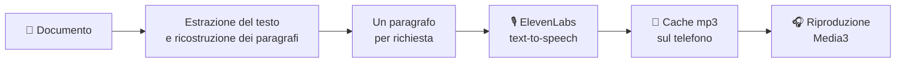

<div align="center">


# Leggimi

**Trasforma i tuoi documenti in audiolibri, con le voci di [ElevenLabs](https://elevenlabs.io).**

PDF, Word, EPUB, appunti: aprili sul telefono e ascoltali mentre guidi, cucini o cammini.

[](https://github.com/SimoneFaricelli/leggimi/releases/latest)


### [⬇️ Scarica l'APK](https://github.com/SimoneFaricelli/leggimi/releases/latest)

</div>

---

## ✨ Perché Leggimi

Hai una dispensa, un manuale o un romanzo e niente tempo per leggerlo con gli occhi? Leggimi estrae il testo dal documento, lo divide in paragrafi e lo fa leggere da una voce ElevenLabs. Il risultato è un audiolibro con l'intonazione naturale di un narratore, nella voce che scegli tu.

<table>
<tr>
<td width="50%" valign="top">

### 📚 Qualsiasi documento
PDF, Word, ODT, EPUB, RTF, HTML, Markdown e TXT. Si importano dall'app oppure con **Apri con** e **Condividi** da qualunque altra app.

</td>
<td width="50%" valign="top">

### 🎙️ La voce che preferisci
Puoi usare tutte le voci del tuo account ElevenLabs, con ricerca, filtri e anteprima. Scegli una voce e un modello per tutti i documenti, oppure una voce diversa per ogni libro.

</td>
</tr>
<tr>
<td valign="top">

### 👆 Tocca e ascolta
Il testo scorre mentre ascolti e il paragrafo in lettura è evidenziato. Tocca un paragrafo qualsiasi e la lettura riparte da lì. L'indice dei capitoli porta direttamente al punto che cerchi.

</td>
<td valign="top">

### 🎧 Come un vero lettore audio
La lettura continua in background, con i comandi in notifica, sulla schermata di blocco e dalle cuffie. Puoi regolare la velocità da 0,75× a 2× e impostare un timer di spegnimento, anche "a fine capitolo".

</td>
</tr>
<tr>
<td valign="top">

### 💰 Paghi una volta sola
L'audio generato resta salvato sul telefono, quindi riascoltare non consuma crediti. Se cambi voce e poi torni a quella di prima, l'app riusa l'audio già pagato.

</td>
<td valign="top">

### 📍 Riprendi da dove eri
Ogni documento ricorda il punto in cui ti sei fermato, e nella libreria vedi a che punto sei di ogni lettura.

</td>
</tr>
</table>

## 🚀 Inizia in tre minuti

1. **Installa.** Scarica `Leggimi-x.y.z.apk` dalle [release](https://github.com/SimoneFaricelli/leggimi/releases/latest) direttamente dal telefono e aprilo. Android ti chiederà di consentire l'installazione da origini sconosciute.
2. **Collega ElevenLabs.** Apri ⚙️ **Impostazioni**, incolla la tua chiave API e premi **Salva e verifica**. Compaiono il tuo piano e i caratteri che ti restano.
   > La chiave la crei su *elevenlabs.io → Settings → API Keys*. Servono almeno i permessi *Text to Speech*, *Voices (read)*, *Models (read)* e *User (read)*.
3. **Scegli voce e modello.**
   - *Eleven Multilingual v2*: la resa migliore in italiano per testi lunghi.
   - *Flash v2.5*: più rapido ed economico.
4. **Aggiungi un documento** dalla libreria e premi ▶️.

## 🧠 Come funziona



<details>
<summary><b>PDF letti come un libro, non come un insieme di righe</b></summary>

<br>

Un PDF non contiene paragrafi, solo righe posizionate sulla pagina. Leggimi ricostruisce i paragrafi guardando posizione, spaziatura e dimensione di ogni riga. Due righe restano unite, tranne quando c'è un segnale chiaro di nuovo paragrafo:

- inizia un punto elenco;
- lo spazio verticale tra le righe è ampio;
- cambia la dimensione del carattere;
- una frase finisce su una riga corta, oppure è seguita da un rientro.

Così:
- gli elenchi puntati restano interi;
- i paragrafi che proseguono alla pagina successiva non si spezzano;
- le parole divise con il trattino vengono ricucite;
- intestazioni, piè di pagina e numeri di pagina ripetuti non vengono letti ad alta voce.

Se i segnalibri del PDF ci sono, diventano l'indice dei capitoli.

</details>

<details>
<summary><b>Intonazione continua e nessuna attesa</b></summary>

<br>

Ogni paragrafo viene inviato a ElevenLabs insieme a circa 500 caratteri di testo precedente e successivo. Così la voce mantiene un'intonazione coerente da un paragrafo all'altro. Mentre ascolti, l'app genera in anticipo i paragrafi successivi, almeno 1.500 caratteri, per passare all'audio seguente senza pause.

</details>

<details>
<summary><b>Crediti sotto controllo</b></summary>

<br>

ElevenLabs conta i caratteri letti. Gli mp3 vengono salvati in base a testo, voce, modello e regolazioni, quindi riascoltare un brano non costa nulla. Puoi controllare lo spazio occupato e svuotare la cache dalle impostazioni. La velocità di riproduzione si cambia sul telefono e non richiede di rigenerare l'audio.

</details>

## 🔒 Privacy

- **La chiave API** resta sul telefono, cifrata con l'Android Keystore (AES-GCM), e non finisce nei backup.
- **I documenti** vengono copiati nello spazio privato dell'app. Il testo da leggere viene inviato solo a ElevenLabs.
- **Nessun server intermedio**, nessuna statistica d'uso, nessuna pubblicità.

## ❓ Domande frequenti

<details>
<summary><b>Quanto costa?</b></summary>
<br>
L'app è gratuita. Paghi solo i caratteri che ElevenLabs sintetizza, secondo il tuo piano (anche il piano gratuito funziona). Dopo la prima lettura, riascoltare è gratis.
</details>

<details>
<summary><b>Funziona senza connessione?</b></summary>
<br>
Le parti già ascoltate o generate in anticipo sì, perché sono salvate sul telefono. Per generare audio nuovo serve internet.
</details>

<details>
<summary><b>Il mio PDF non si importa: "non contiene testo selezionabile".</b></summary>
<br>
È probabilmente una scansione, cioè contiene immagini delle pagine e non testo. Leggimi non fa riconoscimento ottico dei caratteri (OCR). Passa prima il PDF in uno strumento OCR e poi importalo.
</details>

<details>
<summary><b>E i file .doc (Word 97-2003)?</b></summary>
<br>
Non sono supportati. Salvali come .docx da Word o LibreOffice.
</details>

## 🛠️ Compilare dal codice

Ti serve solo **Docker**. Tutta la toolchain Android (JDK 21, SDK 37, Gradle 9.9) è nell'immagine definita in [`docker/Dockerfile`](docker/Dockerfile).

```bash
build/build.sh                # test + APK debug    → dist/Leggimi-debug.apk
build/build.sh release        # test + APK firmato  → dist/Leggimi-<versione>.apk
build/build.sh -- lintDebug   # qualsiasi task Gradle
```

> [!IMPORTANT]
> La prima build `release` crea un keystore in `~/.leggimi-keystore/`. **Fanne un backup**: senza quel keystore non potrai installare aggiornamenti sopra l'app esistente.

In [`samples/`](samples) trovi tre documenti di prova (DOCX, PDF, Markdown).

<details>
<summary><b>Struttura del progetto</b></summary>

```
app/src/main/java/it/faricelli/leggimi/
  data/extract/   estrattori di testo, uno per formato (PDF: ricostruzione dei paragrafi)
  data/text/      modello del documento e Segmenter (paragrafi → richieste di sintesi)
  data/eleven/    client REST di ElevenLabs
  data/audio/     cache degli mp3
  data/db/        Room: libreria e posizione di lettura
  data/settings/  DataStore e chiave API cifrata
  player/         PlayerEngine (coda, prefetch, timer) e PlaybackService (Media3)
  ui/             schermate Compose: libreria, lettore, impostazioni, scelta di voce e modello
```

**Stack**: Kotlin · Jetpack Compose (Material 3) · Media3 ExoPlayer · Room · DataStore · OkHttp · kotlinx.serialization · PdfBox-Android · Jsoup · commonmark.

</details>

---

<div align="center">
<sub>Fatto con ☕ e tanta voglia di ascoltare invece di leggere.</sub>
</div>
